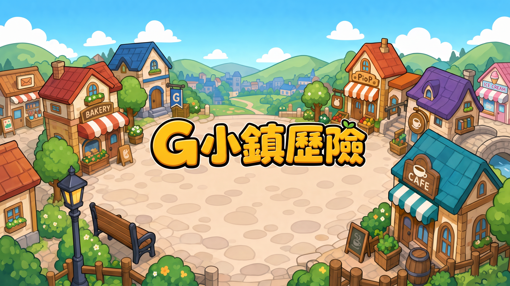

# Gtown



Gtown 是一個基於 [AirConsole](https://www.airconsole.com/) 框架開發的多人派對遊戲合集（Party Game Hub），玩家無需安裝任何 App，直接用手機瀏覽器連線當搖桿，即可在電視或電腦大螢幕上與朋友一起進行多款小遊戲對戰。

本專案是我在 **2026 年 7 月至 8 月於 Garena 擔任 Game Incubation Intern** 實習期間，從零孵化的作品。整個實習期間獨立完成從遊戲企劃、核心玩法設計、前端開發到多款小遊戲整合的完整流程，目標是驗證「輕量、免安裝、手機即搖桿」的派對遊戲體驗是否能快速落地並帶來樂趣。

## 專案內容

目前收錄 10 款風格各異的小遊戲，涵蓋格鬥、競速、物理解謎、競標等玩法：

1. 狂瘋醫院
2. 熱血排球
3. 乒乓對戰
4. 卡車亂鬥
5. 爬高派對
6. 攀爬
7. 噴漆貼紙
8. 危台求生
9. 噴槍佔地
10. 村莊拍賣

每款遊戲共用同一套 screen / controller 架構，新增遊戲只需在 `src/games` 下新增模組並註冊到 `registry.js`，方便快速擴充。

## 技術架構

- **AirConsole** 作為多人連線框架，負責裝置配對與即時訊息傳輸
- **Vite** 作為開發與打包工具
- **Matter.js** 處理遊戲物理運算
- **d3-delaunay** 用於部分遊戲的幾何運算
- 架構分為 `screen.html`（電視端顯示）與 `controller.html`（手機端操作），透過 AirConsole 即時連線同步狀態

## 開發

```bash
npm install
npm run dev      # 啟動開發伺服器
npm run build     # 打包
npm run zip       # 打包並產出 game.zip
```
